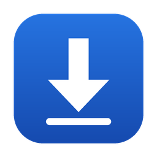
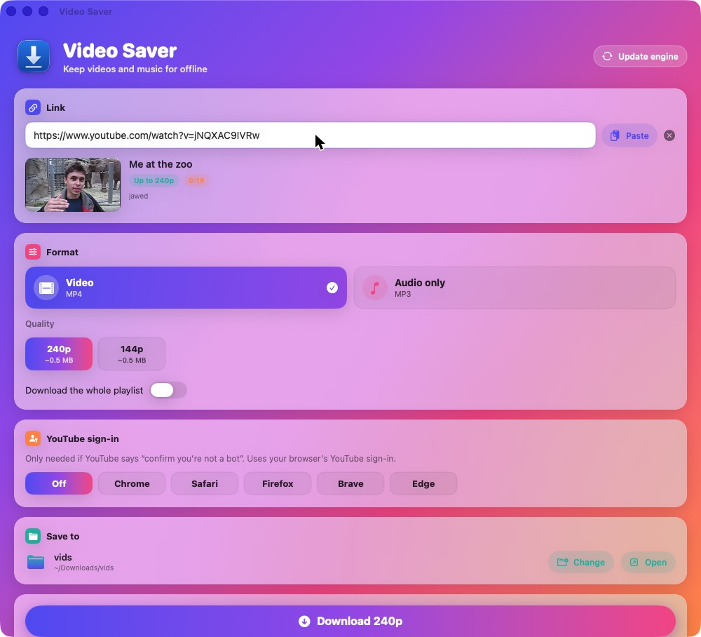
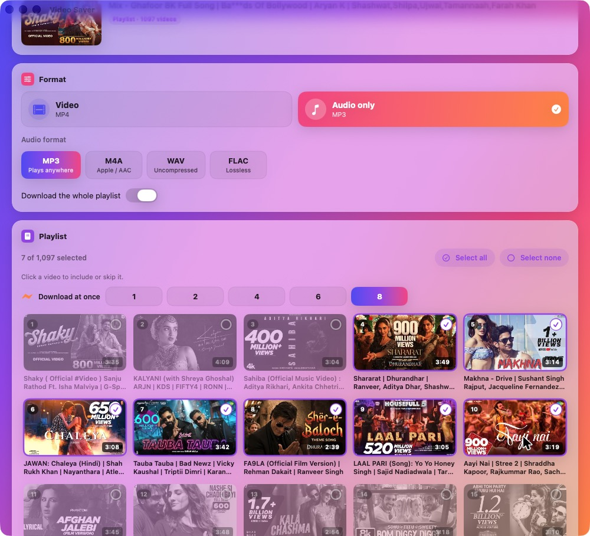
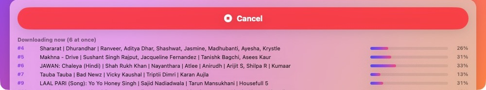
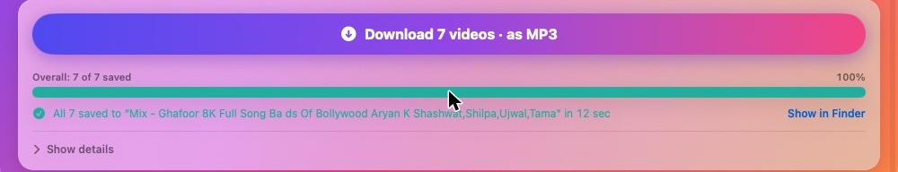

<p align="center">
  
</p>

<h1 align="center">Video Saver</h1>

<p align="center">
  A native macOS app for saving YouTube videos and music for offline use.<br>
  Paste a link, pick a quality or MP3, click Download. Works with whole playlists, in parallel.
</p>

<p align="center">
  
  
  
</p>

---

## Screenshots

**Single video**: paste a link and the app reads the title, thumbnail and **the qualities that video actually has**, then picks the highest automatically.



**Playlists**: every video appears as a thumbnail. All are selected by default; click any to skip it. Choose how many download at once.



**Parallel downloads**: each active download gets its own progress bar, plus an overall bar and time remaining.





---

## Features

- **Video (MP4)**: lists the real resolutions for each video (4K, 1080p, 720p…) with approximate file sizes and auto-selects the best. It prefers H.264 + AAC, so files play on every Mac and iPhone.
- **Audio only**: MP3 (with cover art), M4A, WAV or FLAC.
- **Whole playlists and Mixes**:
  - Thumbnail grid with select all, select none, or click to include or skip each video.
  - Saved into a folder named after the playlist, with files numbered in playlist order.
- **Parallel downloads**: 1, 2, 4, 6 or 8 at once (default 4). Each file also downloads its fragments in parallel.
- **Live progress**:
  - A bar for each active download, plus an overall bar and estimated time left.
  - Per-thumbnail badges: percentage, then *Saved* or *Failed*.
- **Remembers your settings**: save folder, format, audio type and parallel count.
- **YouTube sign-in helper**: if YouTube says *"confirm you're not a bot"*, pick your browser (Chrome, Safari, Firefox, Brave or Edge) and the app uses that browser's YouTube sign-in.
- **Update engine** button: keeps `yt-dlp` current with one click. YouTube changes often, and this fixes most sudden failures.
- **Cancel** at any time. Files already finished are kept.

---

## Requirements

| | |
|---|---|
| macOS | 13 Ventura or newer (Apple Silicon or Intel) |
| Xcode Command Line Tools | for the Swift compiler. The build script prompts you to install them if missing. |
| [Homebrew](https://brew.sh) | used to install `yt-dlp` and `ffmpeg` |

You **don't** need the full Xcode app.

---

## Install

### Option A: one command (recommended)

Open **Terminal** and run:

```bash
git clone https://github.com/rahul576/youtube_downloader.git
cd youtube_downloader
bash build.sh --install
```

This will:
1. Check for the Xcode Command Line Tools. If they're missing, a macOS dialog appears: click **Install**, then run the command again.
2. Install `yt-dlp` and `ffmpeg` with Homebrew if they're missing.
3. Compile the app, ad-hoc sign it for your Mac, copy **Video Saver** into **/Applications** and open it.

### Option B: double-click

1. Download this repo (**Code → Download ZIP**) and unzip it.
2. Double-click **`Build and Install.command`**.
   - If macOS says it can't be opened because it's from an unidentified developer, **right-click → Open → Open**. This is only needed once.
3. A Terminal window shows the build. When it says *Done*, the app is in **/Applications**.

### Don't have Homebrew?

Install it first (one line, from [brew.sh](https://brew.sh)), then run Option A again:

```bash
/bin/bash -c "$(curl -fsSL https://raw.githubusercontent.com/Homebrew/install/HEAD/install.sh)"
```

---

## How to use

### A single video
1. Copy a YouTube link and click **Paste**, or paste with ⌘V.
2. Wait a moment while the app reads the video. The thumbnail and available qualities appear.
3. Choose **Video** (pick a resolution) or **Audio only** (pick MP3 / M4A / WAV / FLAC).
4. Optionally change **Save to** (default: Downloads).
5. Click **Download**. When it finishes, click **Show in Finder**.

### A playlist or Mix
1. Turn on **Download the whole playlist**.
2. Paste a link that contains `list=`. This can be a playlist page or a video played from a playlist.
3. All videos load as thumbnails. Use **Select none**, then click the ones you want, or click to skip the ones you don't.
4. Choose **Download at once** (4 is a good balance; 8 is fastest).
5. Choose Video or **Audio only → MP3** and click **Download N videos**.

Files are saved to `<Save to folder>/<Playlist name>/001 - Title.mp3`, `002 - …`, and so on.

> **Tip:** YouTube *Mix* playlists (links with `list=RD…`) can have hundreds or thousands of entries. Use **Select none** first and then pick just the songs you want.

---

## Troubleshooting

| Problem | Fix |
|---|---|
| Downloads suddenly fail | Click **Update engine** (top right). YouTube changes often and `yt-dlp` updates fix it. |
| "Confirm you're not a bot" | Under **YouTube sign-in**, choose the browser where you're signed in to YouTube. macOS may ask once for permission to read that browser's cookies. Lower **Download at once** if it keeps happening. |
| "yt-dlp not found" / "ffmpeg not found" | Run `brew install yt-dlp ffmpeg` |
| Build says Command Line Tools are missing | Run `xcode-select --install`, finish the installer, then build again |
| Video won't play in QuickTime | Pick a lower resolution. 4K/8K on YouTube is usually VP9/AV1, which older Macs can't play. |
| Want to see what happened | Expand **Show details** at the bottom of the window for the full log |

---

## Project layout

```
Sources/
  YTDownloaderApp.swift   SwiftUI window, cards, playlist grid, progress UI
  Downloader.swift        yt-dlp runner: link inspection, parallel job pool, progress parsing
Resources/
  Info.plist              App bundle metadata
  AppIcon.icns            App icon
build.sh                  Compiles, signs and (optionally) installs the app
Build and Install.command Double-clickable wrapper around build.sh --install
docs/                     README images
```

### How it works
- The app is a front end for **[yt-dlp](https://github.com/yt-dlp/yt-dlp)** and **[ffmpeg](https://ffmpeg.org)**.
- **Reading a link:** pasting a link runs `yt-dlp -J --flat-playlist` to read the title, formats and playlist entries without downloading anything.
- **Downloading:** each download runs one `yt-dlp` process. Playlists use a small worker pool that keeps *N* processes busy. Progress is parsed from yt-dlp's `--newline` output.
- **Settings** are stored with `UserDefaults`. Nothing is sent anywhere except to the video site itself.

### Rebuilding after changes
```bash
bash build.sh            # builds "Video Saver.app" in this folder
bash build.sh --install  # builds and copies it to /Applications
```

---

## Legal

Only download content you own or have permission to save. YouTube's Terms of Service restrict downloading outside its own offline features, and copyright laws in your country apply. This project is provided as-is for personal use, under the [MIT License](LICENSE).
