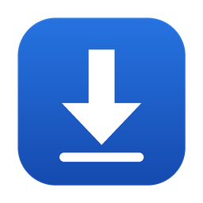
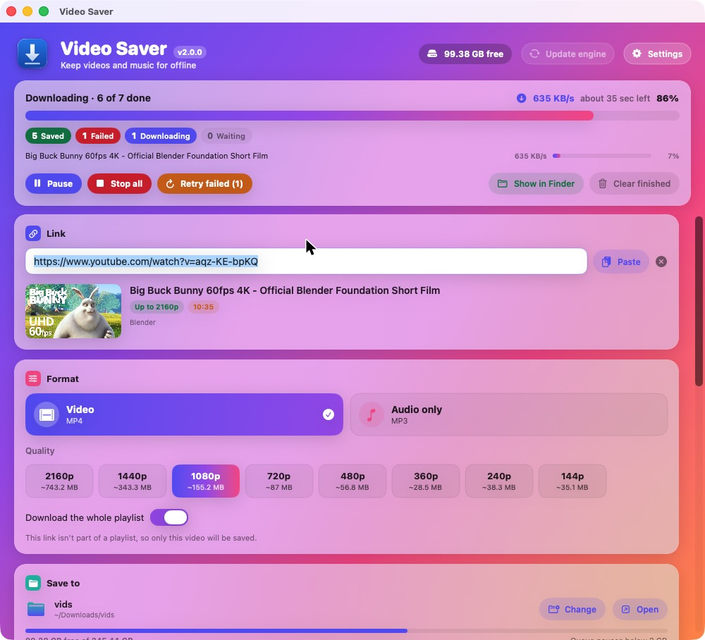
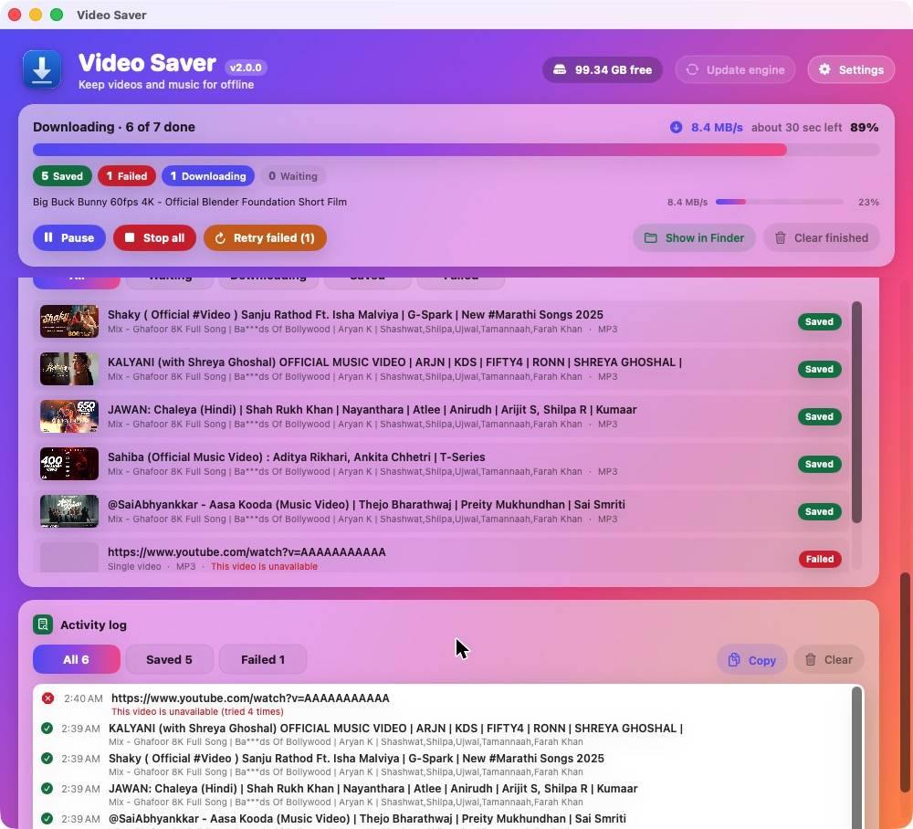
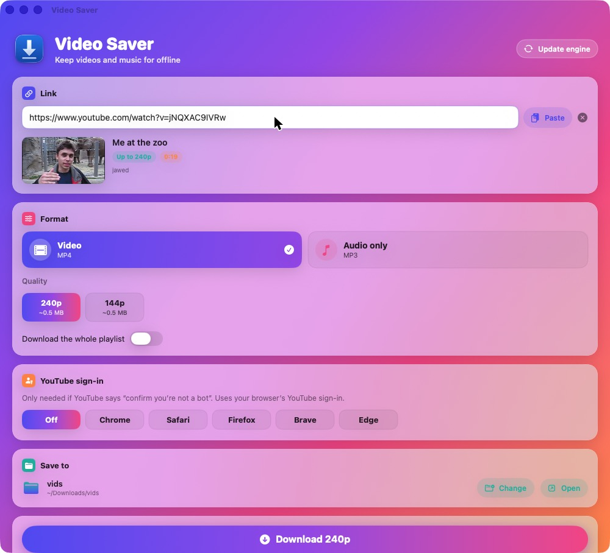
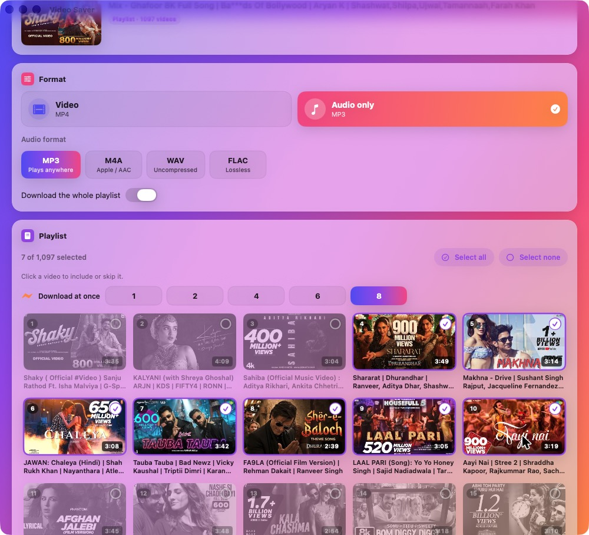
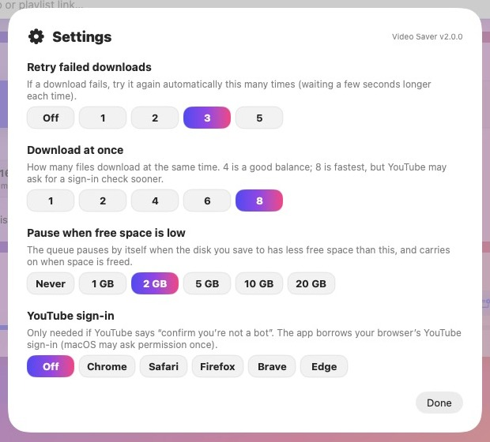

<p align="center">
  
</p>

<h1 align="center">Video Saver</h1>

<p align="center">
  A native macOS app for saving YouTube videos and music for offline use.<br>
  Paste a link, pick a quality or MP3, and add it to the queue. Handles whole playlists, downloads in parallel,
  retries failures automatically and watches your free disk space.
</p>

<p align="center">
  <a href="https://github.com/rahul576/youtube_downloader/releases/latest"></a>
  
  
  
  
</p>

---

## What's new in 2.0

- **Download queue**: add videos and playlists one after another, even while downloads are running.
- **Automatic retries**: a failed download is retried 3 times by default (choose 0–5 in Settings), waiting a little longer each time.
- **Retry failed** button: sends every failed download back into the queue with one click.
- **Progress pinned at the top**:
  - Overall progress and live **total download speed** across all parallel downloads.
  - Time remaining, plus Saved / Failed / Downloading / Waiting counts.
  - Pause, Resume and Stop all buttons.
- **Free-space tracking**: the free space on the disk you save to is always shown. The queue pauses by itself when space runs low (2 GB by default) and carries on once space is freed.
- **Cleaner activity log**: shows only saved and failed downloads, with the reason for each failure. Filter it, or copy it to the clipboard.
- **Readable colours**: success and failure messages are now white text on solid green or amber.
- **Settings panel** for retries, parallel downloads, the low-space limit and YouTube sign-in.
- **Ready-made app download**: a universal build for Apple Silicon and Intel on the [Releases page](https://github.com/rahul576/youtube_downloader/releases).

See [CHANGELOG.md](CHANGELOG.md) for the full list.

---

## Screenshots

**Progress panel**: pinned at the top, showing overall progress, total speed across all downloads, counts by state, and Pause / Stop / Retry failed.



**Queue and activity log**: every queued file with its state, and a log that lists only what was saved or failed (and why).



**Single video**: paste a link and the app reads the title, the thumbnail and **the qualities that video actually has**, then picks the highest.



**Playlists**: every video appears as a thumbnail. All are selected by default; click any to skip it.



**Settings**



---

## Features

- **Video (MP4)**: lists the real resolutions for each video (4K, 1080p, 720p…) with approximate file sizes and auto-selects the best. It prefers H.264 + AAC, so files play on every Mac and iPhone.
- **Audio only**: MP3 (with cover art), M4A, WAV or FLAC.
- **Whole playlists and Mixes**:
  - Thumbnail grid with select all, select none, or click to include or skip each video.
  - Saved into a folder named after the playlist, with files numbered in playlist order.
- **Queue**: keep adding single videos or playlists while others download. Duplicates are skipped. Remove waiting items, filter the list, and clear finished ones.
- **Parallel downloads**: 1, 2, 4, 6 or 8 at once. Each file also downloads its pieces in parallel.
- **Automatic retries** with a growing pause between tries, plus a one-click **Retry failed**.
- **Live progress**:
  - Overall bar and total MB/s across all downloads, with time remaining.
  - A row for each active download (title, speed, percentage).
  - Per-thumbnail badges: Queued, percentage, Saved or Failed.
- **Free-space guard**: free space is shown in the header and under *Save to*. The queue pauses below your limit and resumes once space is freed.
- **Keeps your Mac awake** while the queue is working, and stops all downloads cleanly when you quit.
- **YouTube sign-in helper**: if YouTube says *"confirm you're not a bot"*, choose your browser (Chrome, Safari, Firefox, Brave or Edge) in Settings and the app uses that browser's YouTube sign-in.
- **Update engine** button: keeps `yt-dlp` current with one click. YouTube changes often, and this fixes most sudden failures.
- **Remembers your settings**: save folder, format, audio type, parallel count, retries and low-space limit.

---

## Requirements

| | |
|---|---|
| macOS | 13 Ventura or newer (Apple Silicon or Intel) |
| [Homebrew](https://brew.sh) | to install `yt-dlp` and `ffmpeg`, which do the actual downloading |
| Xcode Command Line Tools | only if you build from source (Option B). The build script offers to install them. |

---

## Install

### Option A: download the app (quickest)

1. Install the download engine once, in **Terminal**:
   ```bash
   brew install yt-dlp ffmpeg
   ```
   No Homebrew? Install it first from [brew.sh](https://brew.sh) (one line), then run the command above.
2. Download **`VideoSaver-v2.0.0-macOS.zip`** from the [latest release](https://github.com/rahul576/youtube_downloader/releases/latest) and unzip it.
3. Drag **Video Saver** into your **Applications** folder.
4. The first time, **right-click the app → Open → Open**. The app isn't notarized by Apple, so macOS asks once.
   - On macOS 15 Sequoia or newer, if there's no **Open** button: try to open the app once, then go to **System Settings → Privacy & Security** and click **Open Anyway**.

### Option B: build from source

```bash
git clone https://github.com/rahul576/youtube_downloader.git
cd youtube_downloader
bash build.sh --install
```

This checks for the Xcode Command Line Tools, installs `yt-dlp` and `ffmpeg` with Homebrew if they're missing, then compiles the app, signs it for your Mac and puts it in **/Applications**.

Prefer double-clicking? Download the repo (**Code → Download ZIP**), unzip it and double-click **`Build and Install.command`**. If macOS blocks it the first time, right-click → Open.

### Updating from 1.x

Use either option above. The new app replaces the old one, and your saved settings (folder, format, parallel count) carry over.

---

## How to use

### A single video
1. Copy a YouTube link and click **Paste**, or paste with ⌘V. The thumbnail and available qualities appear.
2. Choose **Video** (pick a resolution) or **Audio only** (MP3 / M4A / WAV / FLAC).
3. Optionally change **Save to** (default: Downloads).
4. Click **Download**, or press Return.

### A playlist or Mix
1. Turn on **Download the whole playlist**.
2. Paste a link that contains `list=`. All videos load as thumbnails.
3. Use **Select none**, then click the ones you want, or click to skip the ones you don't.
4. Click **Download N videos**. Files go to `<Save to>/<Playlist name>/001 - Title.mp3`, `002 - …`, and so on.

> **Tip:** YouTube *Mix* playlists (links with `list=RD…`) can hold hundreds or thousands of entries. Select none first, then pick the songs you want.

### Using the queue
- While something is downloading, the button changes to **Add to queue**. Paste another link (video or playlist), choose a format and add it. It starts as soon as a slot is free.
- Each item keeps the format and folder it was added with, so you can mix MP3 playlists and 1080p videos in one queue.
- The **progress panel** at the top shows:
  - The overall bar, total speed and time left.
  - Counts: Saved, Failed, Downloading, Waiting and Retrying.
  - Every active download with its own bar.
- **Pause** stops new downloads from starting; current ones finish. **Resume** carries on. **Stop all** interrupts everything.
- Failed downloads retry automatically. Anything that still fails stays in the list. Press **Retry failed** to try those again, or check the **Activity log** for the reason.
- **Clear finished** tidies up the list. The **Queue** card can show All, Waiting, Downloading, Saved or Failed.

### Settings (⚙︎ in the header)
| Setting | Default | What it does |
|---|---|---|
| Retry failed downloads | 3 | Extra attempts after a failure (0–5), waiting 5 s, 10 s, 15 s… between tries |
| Download at once | 4 | How many files download in parallel (1–8) |
| Pause when free space is low | 2 GB | Pauses the queue below this much free space on the save disk (or *Never*) |
| YouTube sign-in | Off | Uses your browser's YouTube sign-in when YouTube asks to confirm you're not a bot |

---

## Troubleshooting

| Problem | Fix |
|---|---|
| Downloads suddenly fail | Click **Update engine** (top right). YouTube changes often and `yt-dlp` updates fix it. |
| "Confirm you're not a bot" | Open **Settings → YouTube sign-in** and pick the browser where you're signed in to YouTube. Lowering **Download at once** helps too. |
| Queue says *Paused: less than 2 GB free* | Free up space on that disk: the queue resumes by itself. Or lower or switch off the limit in Settings. |
| "yt-dlp not found" / "ffmpeg not found" | Run `brew install yt-dlp ffmpeg` |
| macOS says the app can't be opened | Right-click → **Open**, or **System Settings → Privacy & Security → Open Anyway** |
| Build says Command Line Tools are missing | Run `xcode-select --install`, finish the installer, then build again |
| Video won't play in QuickTime | Pick a lower resolution. 4K/8K on YouTube is usually VP9/AV1, which older Macs can't play. |

---

## Project layout

```
Sources/
  YTDownloaderApp.swift   SwiftUI: progress panel, link/format/playlist cards, queue, activity log, settings
  Downloader.swift        Engine: link inspection, download queue + worker pool, retries, speed, disk space
Resources/
  Info.plist              App bundle metadata (version)
  AppIcon.icns            App icon
build.sh                  Build (--install to copy to /Applications, --dist for a universal release zip)
Build and Install.command Double-clickable wrapper around build.sh --install
CHANGELOG.md              Version history
docs/                     README images
```

### How it works
- The app is a front end for **[yt-dlp](https://github.com/yt-dlp/yt-dlp)** and **[ffmpeg](https://ffmpeg.org)**.
- **Reading a link:** pasting a link runs `yt-dlp -J --flat-playlist` to read the title, formats and playlist entries without downloading anything.
- **The queue:** every file in the queue is one task. A worker pool keeps up to *N* `yt-dlp` processes running and starts the next task as each finishes.
- **Progress and speed** are parsed from each process's `--newline` output. The speed shown at the top is the sum across all processes.
- **Retries:** a failed task goes back to the queue with a timed delay until its retry budget is used up.
- **Disk space:** free space comes from the save folder's volume (`volumeAvailableCapacityForImportantUsage`), checked every 5 seconds.
- Settings are stored with `UserDefaults`. Nothing is sent anywhere except to the video site itself.

### Building a release
```bash
bash build.sh --dist     # universal (arm64 + x86_64) app -> dist/VideoSaver-v<version>-macOS.zip
```

---

## Legal

Only download content you own or have permission to save. YouTube's Terms of Service restrict downloading outside its own offline features, and copyright laws in your country apply. This project is provided as-is for personal use, under the [MIT License](LICENSE).
